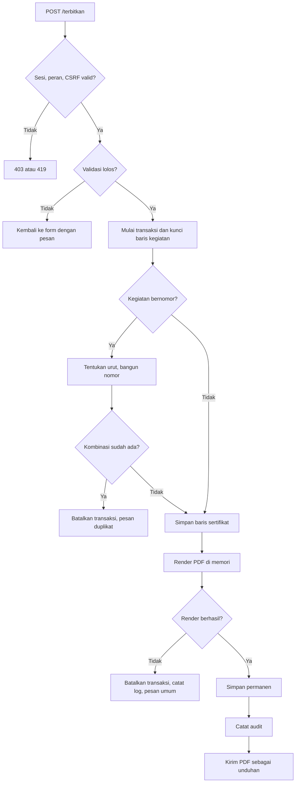

# Generator Sertifikat XCODE

**Business Flow**

Alur bisnis secara rinci: pelaku, perjalanan utama, alur tiap modul, status, aturan, dan pengecualian

**Produk:** Generator Sertifikat XCODE, aplikasi web berbasis Laravel 12 untuk menerbitkan sertifikat seminar/webinar dan bootcamp/magang sebagai PDF

**Penyusun:** [isi nama peserta magang]

**Tech stack implementasi:** Laravel 12, PHP 8.2+, Eloquent ORM, Blade, TCPDF

**Versi:** Draf 1.1, 18 November 2026

**Dokumen terkait:** Konsep Ide, PRD, Design System

---

## 1. Pelaku dan pertukaran nilai

| Pelaku | Memberi | Menerima |
|---|---|---|
| Operator | Data peserta dan kegiatan, waktu | Nomor yang benar, PDF siap kirim, riwayat |
| Admin | Data master kegiatan, pengelolaan akses, keputusan pembatalan | Sistem yang tertib dan dapat diaudit |
| Peserta | Nama dan kehadiran (diurus di luar aplikasi) | Sertifikat PDF dari operator |
| Coach / perusahaan | Aturan nomor, templat, wewenang penerbitan | Penerbitan yang tidak bergantung pada satu staf |
| Generator (sistem) | Penomoran, render PDF, pencatatan | Data dari form dan data master |

Peserta tidak memiliki akun. Pengiriman PDF ke peserta dilakukan operator di luar aplikasi. Tidak ada uang yang berpindah di dalam aplikasi.

---

## 2. Perjalanan utama operator

Alur ujung ke ujung dari masuk ke aplikasi sampai sertifikat seminar sampai di tangan peserta. Ini juga alur yang dipakai untuk uji penerimaan.

| No | Pelaku | Aksi | Respons sistem | Hasil |
|---|---|---|---|---|
| 1 | Operator | Membuka aplikasi dan memasukkan username dan kata sandi | Memeriksa akun, membuat sesi, mencatat ke audit | Halaman Terbitkan |
| 2 | Operator | Memilih jenis Seminar/Webinar | Menampilkan field seminar | Form seminar |
| 3 | Operator | Memilih kegiatan dari daftar | Mengisi kode dan penerbit, menghitung saran nomor urut | Nomor saran di panel ringkasan |
| 4 | Operator | Mengetik nama peserta | Memeriksa karakter dan panjang | Nama valid |
| 5 | Operator | Menyesuaikan nomor urut sesuai daftar peserta, memeriksa tanggal terbit | Memperbarui pratinjau nomor lengkap | Nomor lengkap tampil |
| 6 | Operator | Menekan Pratinjau | Membuat PDF bertanda air PRATINJAU tanpa menyimpan apa pun | PDF terbuka di tab baru |
| 7 | Operator | Memeriksa nama, judul, posisi, dan panjang teks | Tidak ada | Siap diterbitkan |
| 8 | Operator | Menekan Terbitkan & Unduh | Menjalankan penerbitan atomik: kunci kegiatan, buat nomor, simpan, render PDF, simpan permanen | Sertifikat berstatus Terbit |
| 9 | Sistem | Setelah penyimpanan permanen | Mengirim PDF sebagai unduhan dan mencatat ke audit | Berkas `Sertifikat_Seminar_Nama.pdf` |
| 10 | Operator | Mengirim PDF ke peserta lewat saluran di luar aplikasi | Tidak ada | Peserta menerima sertifikat |
| 11 | Operator | Mengulangi untuk peserta berikutnya | Saran nomor urut naik, kegiatan tetap terpilih | Sertifikat berikutnya |
| 12 | Operator / Admin | Membuka Riwayat untuk memeriksa atau mengunduh ulang | Merender ulang dari data tersimpan | PDF identik |

---

## 3. Alur per modul

### 3.1 Masuk dan keluar

| No | Pelaku | Aksi | Respons sistem | Hasil |
|---|---|---|---|---|
| 1 | Pengguna | Membuka alamat aplikasi tanpa sesi | Mengarahkan ke halaman Masuk | Form masuk |
| 2 | Pengguna | Mengisi username dan kata sandi, menekan Masuk | Memeriksa akun aktif, tidak terkunci, kata sandi cocok | Sesi dibuat |
| 3 | Sistem | Berhasil | Mengganti id sesi, mereset hitungan gagal, mencatat audit | Halaman Terbitkan |
| 4 | Sistem | Gagal | Menambah hitungan gagal, mencatat audit, menampilkan pesan umum | Tetap di form masuk |
| 5 | Sistem | Lima gagal berturut-turut | Mengunci akun 10 menit | Pesan menyebut waktu buka kunci |
| 6 | Pengguna | Menekan Keluar | Menghapus sesi | Halaman Masuk |

#### Pengecualian masuk

- Akun nonaktif: pesan sama dengan kata sandi salah agar tidak membocorkan keberadaan akun.
- Sesi habis setelah 8 jam tanpa aktivitas: diarahkan ke Masuk, lalu kembali ke halaman semula.
- Token CSRF tidak valid: halaman 419 dengan satu tombol Muat Ulang.

### 3.2 Menerbitkan sertifikat seminar/webinar

| No | Pelaku | Aksi | Respons sistem | Hasil |
|---|---|---|---|---|
| 1 | Operator | Memilih jenis Seminar/Webinar | Menampilkan field seminar | Form seminar |
| 2 | Operator | Memilih kegiatan | Mengambil kode, judul, penerbit, dan saran nomor urut | Panel ringkasan terisi |
| 3 | Operator | Mengisi nama, seri, nomor urut, tanggal terbit | Memvalidasi dan memperbarui pratinjau nomor | Data siap |
| 4 | Operator | Menekan Terbitkan & Unduh | Memvalidasi ulang di server | Data valid |
| 5 | Sistem | Memulai transaksi | Mengunci baris kegiatan | Penerbitan bergantian per kegiatan |
| 6 | Sistem | Membangun nomor | Memeriksa kombinasi kegiatan, seri, urut, tahun belum dipakai | Nomor lengkap |
| 7 | Sistem | Menyimpan baris sertifikat | Menyalin data cetak dan mencatat versi layout | Baris tersimpan sementara |
| 8 | Sistem | Merender PDF | Memasang latar, teks, nomor, QR | PDF di memori |
| 9 | Sistem | Menyimpan permanen | Menyelesaikan transaksi | Sertifikat Terbit |
| 10 | Sistem | Mengirim PDF | Header unduhan dan nama berkas aman | Berkas terunduh |

#### Pengecualian penerbitan seminar

- Validasi gagal: form kembali dengan pesan per field dan data tetap terisi.
- Nomor sudah dipakai: transaksi dibatalkan, pesan menyebut nomor itu dan menawarkan saran nomor berikutnya.
- Render PDF gagal: transaksi dibatalkan, tidak ada baris tersimpan, nomor tetap bebas, pesan umum dan kode rujukan tampil, kesalahan masuk ke log.
- Nama terlalu panjang meski huruf sudah dikecilkan: nama dipecah dua baris, bila tetap tidak muat penerbitan ditolak dengan pesan.
- Nama yang sama sudah terbit pada kegiatan itu: peringatan menyebut nomor yang ada, operator boleh melanjutkan.
- Dua operator menerbitkan bersamaan: yang kedua menunggu penguncian lalu memperoleh nomor berikutnya. Bila keduanya mengisi nomor urut yang sama, yang kedua ditolak sebagai duplikat.
- Koneksi putus setelah penyimpanan permanen tetapi sebelum unduhan sampai: sertifikat sudah ada di Riwayat dan dapat diunduh ulang.

### 3.3 Menerbitkan sertifikat bootcamp/magang

| No | Pelaku | Aksi | Respons sistem | Hasil |
|---|---|---|---|---|
| 1 | Operator | Memilih jenis Bootcamp/Magang | Menampilkan field bootcamp | Form bootcamp |
| 2 | Operator | Memilih bootcamp, mis. X-Code Bootcamp #14 | Mengisi program bawaan bila ada | Program terisi |
| 3 | Operator | Mengisi nama, perusahaan, tanggal mulai, tanggal selesai, tanggal terbit | Memvalidasi tanggal mulai tidak setelah tanggal selesai | Data siap |
| 4 | Operator | Menekan Pratinjau (opsional) | Membuat PDF bertanda air PRATINJAU | PDF di tab baru |
| 5 | Operator | Menekan Terbitkan & Unduh | Menyimpan sertifikat tanpa nomor dan urut, merender PDF tanpa nomor dan QR | Sertifikat Terbit |
| 6 | Sistem | Selesai | Mengirim PDF dan mencatat audit | Berkas terunduh |

Bila kegiatan bootcamp memiliki `bernomor` aktif, alur mengikuti 3.2 untuk bagian nomor.

#### Pengecualian bootcamp

- Tanggal selesai lebih awal dari tanggal mulai: ditolak dengan pesan pada field tanggal selesai.
- Paragraf terlalu panjang karena nama perusahaan panjang: huruf paragraf mengecil sampai batas minimum, lalu peringatan tampil di form.
- Peserta yang sama dan kegiatan yang sama sudah pernah terbit: peringatan, operator boleh melanjutkan.

### 3.4 Pratinjau

| No | Pelaku | Aksi | Respons sistem | Hasil |
|---|---|---|---|---|
| 1 | Operator | Menekan Pratinjau | Memvalidasi data seperti penerbitan | Data valid |
| 2 | Sistem | Menyusun data tanpa transaksi | Memakai nomor saran sebagai contoh | Tidak ada nomor terpakai |
| 3 | Sistem | Merender PDF | Memberi tanda air PRATINJAU | PDF inline |
| 4 | Operator | Memeriksa di tab baru | Tidak ada | Siap atau perlu perbaikan |

Pratinjau tidak menulis ke riwayat dan tidak menambah hitungan nomor.

### 3.5 Riwayat dan unduh ulang

| No | Pelaku | Aksi | Respons sistem | Hasil |
|---|---|---|---|---|
| 1 | Pengguna | Membuka Riwayat | Menampilkan daftar terbaru dari semua pengguna | Daftar |
| 2 | Pengguna | Mencari nama atau nomor, menyaring jenis, status, atau tanggal | Menyaring daftar | Hasil saringan |
| 3 | Pengguna | Membuka detail satu sertifikat | Menampilkan data cetak, nomor, pembuat, status | Detail |
| 4 | Pengguna | Menekan Unduh Ulang | Merender dari data cetak dan versi layout yang tercatat | PDF identik |
| 5 | Sistem | Setelah unduh | Mencatat audit unduh ulang | Jejak |

### 3.6 Pembatalan dan koreksi

| No | Pelaku | Aksi | Respons sistem | Hasil |
|---|---|---|---|---|
| 1 | Operator | Menemukan kesalahan pada sertifikat yang sudah terbit | Tidak ada | Meminta Admin membatalkan |
| 2 | Admin | Membuka detail sertifikat dan menekan Batalkan | Menampilkan dialog meminta alasan | Dialog konfirmasi |
| 3 | Admin | Mengisi alasan dan mengonfirmasi | Mengubah status menjadi Dibatalkan, menyimpan alasan, pelaku, waktu | Sertifikat Dibatalkan |
| 4 | Operator | Menerbitkan sertifikat pengganti dengan data benar | Memberi nomor urut baru (nomor lama tidak dipakai ulang) | Sertifikat baru |

**[ASUMSI]** Nomor yang dibatalkan tidak dipakai ulang. Bila coach meminta koreksi memakai nomor yang sama, aturan keunikan perlu diubah (lihat PRD bagian 9, nomor 9).

### 3.7 Kelola kegiatan (Admin)

| No | Pelaku | Aksi | Respons sistem | Hasil |
|---|---|---|---|---|
| 1 | Admin | Membuka Kegiatan | Menampilkan daftar dengan pencarian dan saringan | Daftar kegiatan |
| 2 | Admin | Menekan Tambah Kegiatan | Menampilkan form kosong | Form |
| 3 | Admin | Mengisi kode, judul, jenis, penerbit, bernomor, pakai QR, program bawaan | Memeriksa kolom wajib | Data valid |
| 4 | Sistem | Kode sudah dipakai kegiatan lain | Meminta konfirmasi dengan menyebut kegiatan yang memakai kode itu | Dialog konfirmasi |
| 5 | Admin | Menyimpan | Menyimpan dan mencatat audit | Kegiatan tersedia di dropdown form |
| 6 | Admin | Menonaktifkan kegiatan yang selesai | Menyembunyikan dari dropdown, sertifikat lama tetap | Kegiatan nonaktif |

### 3.8 Kelola pengguna (Admin)

| No | Pelaku | Aksi | Respons sistem | Hasil |
|---|---|---|---|---|
| 1 | Admin | Menekan Tambah Pengguna dan mengisi data | Memeriksa username unik dan kekuatan kata sandi awal | Akun dibuat |
| 2 | Admin | Mengubah peran atau menonaktifkan | Menolak bila menonaktifkan diri sendiri atau admin aktif terakhir | Perubahan tersimpan |
| 3 | Admin | Menekan Reset Sandi | Membuat kata sandi sementara yang ditampilkan sekali | Akses dipulihkan |

### 3.9 Pengaturan awal dan kalibrasi layout

| No | Pelaku | Aksi | Respons sistem | Hasil |
|---|---|---|---|---|
| 1 | Pengembang | Menjalankan skema SQL dan pembuatan admin awal | Membuat tabel dan akun | Sistem siap |
| 2 | Pengembang | Menjalankan seed kegiatan | Membaca daftar kode, melaporkan baris bermasalah | Kegiatan terisi |
| 3 | Admin | Membuka Uji Layout, memilih jenis, menyalakan Garis Bantu | Membuat PDF contoh dengan grid milimeter di atas latar | PDF uji |
| 4 | Pengembang | Menumpuk PDF uji di atas sertifikat sampel | Tidak ada | Selisih posisi diketahui |
| 5 | Pengembang | Menyesuaikan koordinat di `config/layout`, menaikkan versi layout | Tidak ada | Layout versi baru |
| 6 | Pengembang | Mengulang sampai selisih di bawah 1 mm | Tidak ada | Layout terkalibrasi |

Sertifikat lama tetap memakai versi layout yang tercatat saat terbit, sehingga kalibrasi baru tidak mengubah unduh ulang lama. Untuk itu berkas konfigurasi versi lama dipertahankan.

### 3.10 Aliran penerbitan di server (ringkas)

---

## 4. Daur status

### 4.1 Sertifikat

| Dari | Pemicu | Ke | Pelaku |
|---|---|---|---|
| (baru) | Penerbitan berhasil, PDF terbentuk, transaksi selesai | Terbit | Operator |
| (baru) | Validasi, nomor, atau render gagal | Tidak terbentuk | Sistem |
| Terbit | Admin membatalkan dengan alasan | Dibatalkan | Admin |
| Dibatalkan | (tidak ada jalur kembali) | Dibatalkan | - |

Sertifikat tidak dihapus dan tidak diubah isinya setelah terbit.

### 4.2 Kegiatan

| Dari | Pemicu | Ke | Pelaku |
|---|---|---|---|
| (baru) | Admin menyimpan atau seed berhasil | Aktif | Admin atau sistem |
| Aktif | Admin menonaktifkan | Nonaktif | Admin |
| Nonaktif | Admin mengaktifkan | Aktif | Admin |

### 4.3 Pengguna

| Dari | Pemicu | Ke | Pelaku |
|---|---|---|---|
| (baru) | Admin membuat akun | Aktif | Admin |
| Aktif | Lima gagal masuk berturut-turut | Terkunci 10 menit | Sistem |
| Terkunci | Waktu kunci habis | Aktif | Sistem |
| Aktif | Admin menonaktifkan | Nonaktif | Admin |
| Nonaktif | Admin mengaktifkan | Aktif | Admin |

### 4.4 Permintaan penerbitan (tidak disimpan, hanya alur)

| Dari | Pemicu | Ke | Pelaku |
|---|---|---|---|
| Diisi | Operator menekan Pratinjau atau Terbitkan | Divalidasi | Operator |
| Divalidasi | Validasi gagal | Ditolak, kembali ke form | Sistem |
| Divalidasi | Operator menekan Pratinjau | Pratinjau dibuat | Sistem |
| Divalidasi | Operator menekan Terbitkan | Diproses dalam transaksi | Sistem |
| Diproses | Nomor ganda atau render gagal | Dibatalkan, tidak ada jejak data | Sistem |
| Diproses | Semua langkah berhasil | Diterbitkan | Sistem |

---

## 5. Aturan bisnis

| Kode | Aturan |
|---|---|
| AB-01 | Hanya pengguna aktif yang sudah masuk yang dapat memakai aplikasi. |
| AB-02 | Kegiatan yang dipilih harus aktif dan sesuai jenis sertifikat. |
| AB-03 | Nomor sertifikat dibangun hanya oleh `NumberGenerator::build`. |
| AB-04 | Kode kegiatan disimpan sebagai teks dan boleh sama antar kegiatan setelah konfirmasi Admin. |
| AB-05 | Bulan romawi dan tahun pada nomor mengikuti tanggal terbit, bukan tanggal acara. |
| AB-06 | Nomor urut unik per kombinasi kegiatan, seri, dan tahun terbit. Nomor lengkap unik di seluruh sistem. |
| AB-07 | Nomor urut disarankan sistem dan boleh diubah operator selama belum dipakai. |
| AB-08 | Sertifikat bootcamp tidak bernomor dan tidak ber-QR, kecuali kegiatannya diatur sebaliknya. |
| AB-09 | Nomor hanya terpakai bila PDF berhasil dibuat. |
| AB-10 | Pratinjau tidak memakai nomor dan tidak menyimpan data. Selalu bertanda air. |
| AB-11 | Sertifikat yang sudah terbit tidak dapat diubah. Koreksi dilakukan dengan pembatalan lalu penerbitan baru. |
| AB-12 | Hanya Admin yang dapat membatalkan sertifikat, dan alasan wajib diisi. |
| AB-13 | Nomor sertifikat yang dibatalkan tidak dipakai ulang. **[ASUMSI]** |
| AB-14 | Sertifikat tidak pernah dihapus dari basis data. |
| AB-15 | Unduh ulang memakai data cetak tersimpan dan versi layout yang tercatat, bukan data kegiatan terbaru. |
| AB-16 | Nama peserta dicetak persis seperti yang diketik. Perapian kapitalisasi hanya atas permintaan operator. |
| AB-17 | Tanggal terbit bawaan adalah hari ini menurut zona waktu Asia/Jakarta. |
| AB-18 | Kegiatan yang sudah dipakai sertifikat tidak dapat dihapus, hanya dinonaktifkan. |
| AB-19 | Selalu ada minimal satu Admin aktif. |
| AB-20 | Operator dan Admin melihat semua sertifikat (daftar, detail, unduh ulang). Hanya Admin yang dapat membatalkan. (Diputuskan 2026-11-23.) |
| AB-21 | Semua penerbitan, unduh ulang, pembatalan, dan perubahan data master dicatat di audit. |
| AB-22 | Satu penerbitan menghasilkan tepat satu sertifikat untuk satu peserta. |

---

## 6. Pesan sistem

Aplikasi ini tidak mengirim email. Pesan hanya tampil di layar.

| Peristiwa | Penerima | Tampilan |
|---|---|---|
| Penerbitan berhasil | Operator | Pesan kilat: Sertifikat atas nama {nama} diterbitkan dengan nomor {nomor}. Unduhan dimulai |
| Validasi gagal | Operator | Pesan per field dan ringkasan di atas form |
| Nomor sudah dipakai | Operator | Peringatan menyebut nomor dan menawarkan nomor berikutnya |
| Nama kembar pada kegiatan yang sama | Operator | Peringatan kuning, dapat dilanjutkan |
| Render PDF gagal | Operator | Pesan umum dengan kode rujukan, tanpa detail teknis |
| Sertifikat dibatalkan | Operator dan Admin | Pesan kilat dan penanda pada baris riwayat |
| Akun terkunci | Pengguna | Pesan menyebut lamanya kunci |
| Sesi habis | Pengguna | Halaman Masuk dengan keterangan sesi berakhir |

---

## 7. Alur data antar modul

| Dari | Ke | Data yang mengalir |
|---|---|---|
| Data Kegiatan | Form Penerbitan | Kode, judul, jenis, penerbit, bernomor, pakai QR, program bawaan |
| Form Penerbitan | Penomoran | Kegiatan, seri, urut (opsional), tanggal terbit |
| Penomoran | Form Penerbitan | Saran nomor urut dan pratinjau nomor lengkap |
| Form Penerbitan | Generator PDF | Nama, judul, program, perusahaan, tanggal, nomor |
| Penomoran | Riwayat | Nomor lengkap, seri, urut, tahun |
| Generator PDF | Pengguna | Berkas PDF unduhan atau pratinjau |
| Form Penerbitan | Riwayat | Salinan data cetak dan versi layout |
| Riwayat | Generator PDF | Data cetak tersimpan untuk unduh ulang |
| Semua modul | Audit | Pelaku, aksi, target, waktu, IP |
| Konfigurasi layout | Generator PDF | Posisi, font, ukuran, versi |

---

## 8. Pengembangan setelah versi 1

Bagian ini adalah rencana, bukan klaim capaian.

- **Penerbitan massal.** Unggah CSV atau Excel berisi daftar peserta, sistem menerbitkan banyak sertifikat dengan nomor urut mengikuti baris dan menyajikan satu berkas ZIP.
- **Verifikasi publik.** Halaman cek nomor sertifikat dan QR yang menunjuk ke nomor tertentu, memakai data pada tabel sertifikat.
- **Pengiriman otomatis.** Mengirim PDF ke email peserta.
- **Penerbit dan templat lain.** Siber Expert Asia, Cyber Sentinel Secure, dan jenis baru dengan konfigurasi layout tambahan.
- **Editor posisi.** Tampilan visual untuk memindahkan teks tanpa mengubah berkas konfigurasi.

---

XCODE | Business Flow

---

## 6. Pemetaan implementasi Laravel 12

Alur bisnis pada dokumen ini tetap menjadi acuan perilaku aplikasi. Implementasi teknis wajib memakai Laravel 12 dengan pemetaan berikut:

| Area | Implementasi Laravel 12 |
|---|---|
| Routing | `routes/web.php`, named routes, route model binding bila sesuai |
| Autentikasi | Laravel session guard; login menggunakan username dan password; session regenerate setelah login |
| Otorisasi | Middleware, Gate/Policy, dan role Admin/Operator |
| Validasi | Form Request dan aturan validasi Laravel; validasi server tetap menjadi sumber kebenaran |
| Transaksi penerbitan | `DB::transaction()` dan `lockForUpdate()` pada model kegiatan; unique index database tetap wajib |
| Data | Eloquent Model, relationship, migration, factory, dan seeder |
| Tampilan | Blade layout/components; CSS design tokens; JavaScript melalui Vite |
| PDF | Service `PdfRenderer` menggunakan TCPDF; controller mengembalikan response PDF inline/download |
| Audit dan log | Audit model/table tersendiri; Laravel Log untuk error teknis |
| Pengujian | Feature test dan unit test Laravel dengan PHPUnit/Pest |

Nama route, URL, hak akses, status, dan urutan proses bisnis tidak berubah hanya karena framework diganti. Jangan membuat router, middleware CSRF, session manager, atau koneksi PDO manual.
